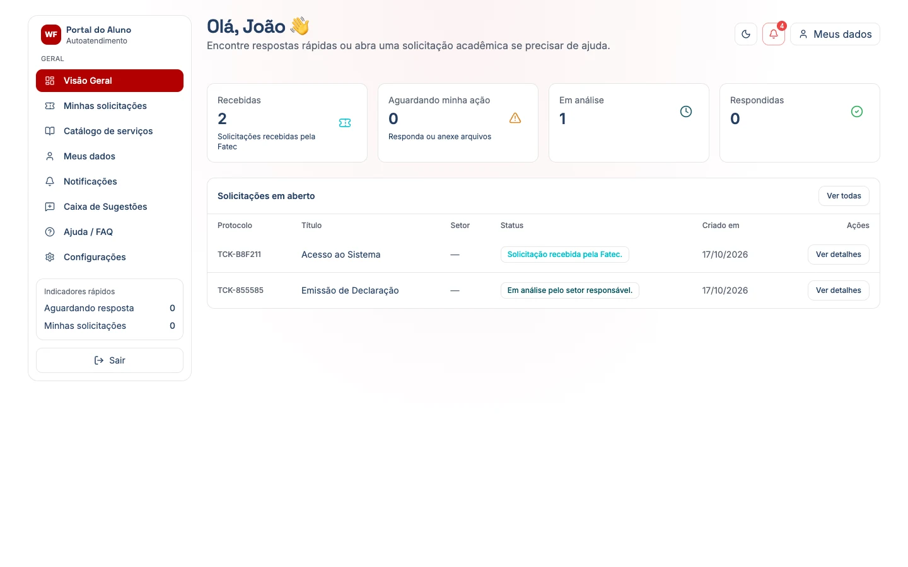
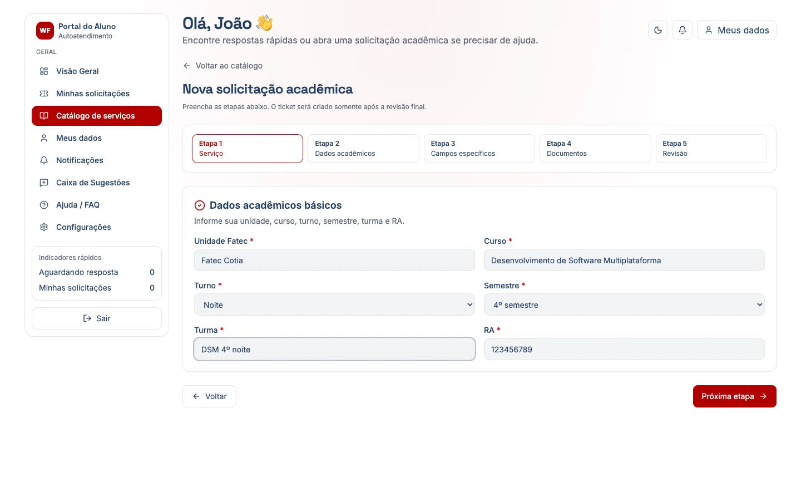
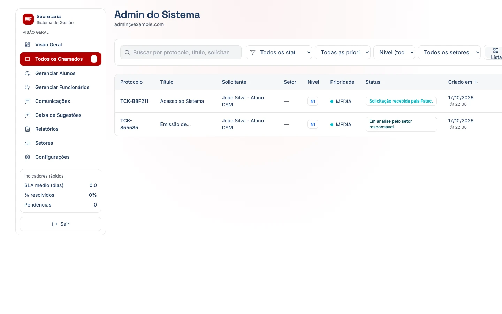
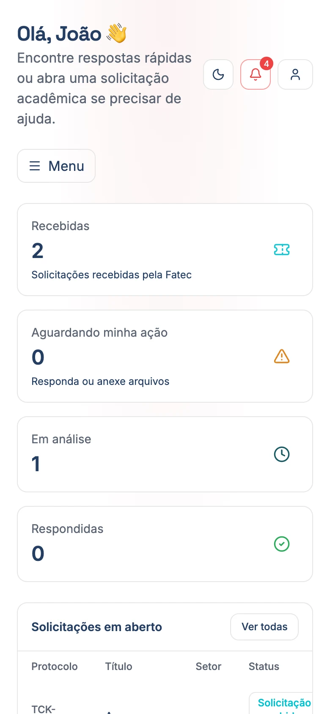

<a href="https://github.com/4dsm2026" target="_blank">
  
</a>

# WorkFlow FATEC — Frontend

[](https://github.com/4dsm2026/frontend_fatecProjeto/actions/workflows/ci.yml)
[](https://github.com/4dsm2026/frontend_fatecProjeto/releases)
[](https://4dsm2026.github.io/docs_fatecProjeto/)


Interface web do **WorkFlow FATEC**, o portal de atendimento acadêmico da Fatec. Tem duas áreas:

- **Portal do Aluno**: o aluno abre solicitações pelo catálogo de serviços, acompanha o andamento, conversa com a secretaria, envia anexos e sugestões;
- **Painel da Secretaria**: a equipe atende os chamados, muda status e prioridade, responde sugestões e acompanha relatórios. Os administradores também cadastram alunos, funcionários e setores.

**API:** [backend_fatecProjeto](https://github.com/4dsm2026/backend_fatecProjeto) · **Manual do usuário:** [site de documentação](https://4dsm2026.github.io/docs_fatecProjeto/) · **Quadro:** [WorkFlow 2026](https://github.com/orgs/4dsm2026/projects/3) · **Como contribuir:** [guia da organização](https://github.com/4dsm2026/.github/blob/main/CONTRIBUTING.md)

| Portal do Aluno | Nova solicitação (assistente em 5 etapas) |
|---|---|
|  |  |
| **Painel da Secretaria** | **No celular** |
|  |  |

<sub>Capturas feitas com os dados de teste do seed. Nenhum dado real.</sub>

## Sumário

- [Stack](#stack)
- [Pré-requisitos](#pré-requisitos)
- [Como rodar localmente](#como-rodar-localmente)
- [Variáveis de ambiente](#variáveis-de-ambiente)
- [Scripts](#scripts)
- [Testes](#testes)
- [Rotas](#rotas)
- [Estrutura do projeto](#estrutura-do-projeto)
- [Problemas comuns](#problemas-comuns)

## Stack

| | |
|---|---|
| Framework | [Next.js 15](https://nextjs.org/) (App Router, Turbopack) + React 19 + TypeScript |
| Estilo | [Tailwind CSS](https://tailwindcss.com/) e ícones [Lucide](https://lucide.dev/) |
| Validação | [Zod](https://zod.dev/) |
| Autenticação | JWT emitido pelo backend, conferido também no servidor do Next (`middleware.ts`, com [jose](https://github.com/panva/jose)) |
| Notificações na tela | [Sonner](https://sonner.emilkowal.ski/) |
| Testes | [Vitest](https://vitest.dev/) + Testing Library + jsdom |

## Pré-requisitos

- **Node.js 20+** e **pnpm** (`corepack enable`). ⚠️ Use sempre `pnpm`, nunca `npm`.
- **O backend rodando** em `http://localhost:3333`, com o banco populado. Siga o [README do backend](https://github.com/4dsm2026/backend_fatecProjeto#como-rodar-localmente) **antes**.

## Como rodar localmente

```bash
git clone https://github.com/4dsm2026/frontend_fatecProjeto.git
cd frontend_fatecProjeto
pnpm install

cp .env.example .env.local     # padrão do Next.js para valores locais
#   → ajuste as variáveis (veja a tabela abaixo)

pnpm dev
```

Abra **http://localhost:3000/login** e entre com um dos [usuários de teste do backend](https://github.com/4dsm2026/backend_fatecProjeto#usuários-de-teste):

- aba **Funcionário**: `admin@example.com` / `wf-fatec2026` → painel da Secretaria;
- aba **Aluno (RA)**: `123456789` / `Fatec@2026` → pede a troca de senha no primeiro acesso e depois abre o Portal do Aluno.

> Se o `pnpm install` mostrar `ERR_PNPM_IGNORED_BUILDS`, rode `pnpm approve-builds`, marque todos com `a`, confirme e rode `pnpm install` de novo.

### ⚠️ O ponto que mais confunde: o segredo JWT

O `middleware.ts` confere o token de novo, no servidor do Next, para proteger `/admin` e `/aluno`. Se `JWT_ACCESS_SECRET`, `JWT_ISSUER` e `JWT_AUDIENCE` do `.env.local` **não forem idênticos** aos do `.env` do backend, a conferência falha em silêncio: o login parece funcionar (aparece a mensagem de sucesso), mas você volta para `/login` sem nenhum erro.

## Variáveis de ambiente

Ficam no `.env.local`, que nunca vai para o git (o hook `pre-commit` bloqueia).

| Variável | Exemplo local | Para quê |
|---|---|---|
| `NEXT_PUBLIC_API_BASE_URL` | `http://localhost:3333` | Endereço da API. É gravada no código no `pnpm build`: mudou, faça o build de novo |
| `JWT_ACCESS_SECRET` | *o mesmo do backend* | Confere o token no `middleware.ts`. Só no servidor, nunca vai para o navegador |
| `JWT_ISSUER` | `helpdesk` | Igual ao do backend |
| `JWT_AUDIENCE` | `helpdesk-app` | Igual ao do backend |
| `BACKEND_URL` | *(opcional)* | Se definida, rotas que o Next não conhece são repassadas para esse endereço (`next.config.mjs`). Sem ela, usa `NEXT_PUBLIC_API_BASE_URL` |

## Scripts

| Comando | O que faz |
|---|---|
| `pnpm dev` | Servidor de desenvolvimento (Turbopack) em `localhost:3000` |
| `pnpm build` / `pnpm start` | Build de produção (`output: standalone`) / roda o build |
| `pnpm lint` | ESLint (`next/core-web-vitals` + TypeScript) |
| `pnpm test` / `pnpm test:watch` | Testes (uma vez / observando) |

O build **não** roda o lint (`ignoreDuringBuilds`). O CI roda lint, testes e build em todo PR para `develop` e `main`.

## Testes

```bash
pnpm test                          # todos
pnpm vitest run tests/api.test.ts  # um arquivo
```

Os testes ficam em `tests/` e rodam em jsdom, sem precisar do backend. Os testes de ponta a ponta, com navegador de verdade, ficam em [test_fatecProjeto](https://github.com/4dsm2026/test_fatecProjeto).

## Rotas

| Área | Rotas | Quem acessa |
|---|---|---|
| Pública | `/login`, `/primeiro-acesso`, `/esqueci-senha`, `/reset-senha`, `/termos`, `/privacidade` | Todos |
| Portal do Aluno | `/aluno/home`, `/aluno/catalogo`, `/aluno/chamados`, `/aluno/sugestoes`, `/aluno/notificacoes`, `/aluno/dados`, `/aluno/ajuda`, `/aluno/configuracoes` | `USUARIO` |
| Painel da Secretaria | `/admin/home`, `/admin/chamados`, `/admin/alunos`, `/admin/funcionarios`, `/admin/setores`, `/admin/comunicacoes`, `/admin/sugestoes`, `/admin/relatorios`, `/admin/notificacoes`, `/admin/configuracoes` | `BACKOFFICE`, `TECNICO`, `ADMINISTRADOR` |

O `middleware.ts` manda para `/login` quem não está autenticado e leva cada perfil para a sua área: um aluno que abre `/admin` vai para `/aluno/home`, e vice-versa.

## Estrutura do projeto

```text
app/
├── (public)/              # login, primeiro acesso, senha, termos
├── (dashboard)/
│   ├── aluno/             # Portal do Aluno (_components/ = menu e topo)
│   └── admin/             # Painel da Secretaria (_components/ = menu, formulários)
└── components/
    ├── ui/                # botões, cards, alertas, diálogo de confirmação
    └── shared/            # badges de status, paginação, menu lateral
utils/
├── api.ts                 # apiFetch: envia o token e renova a sessão no 401
├── auth.ts                # logout
├── catalogo.ts            # catálogo de serviços e formulários do assistente
└── types.ts
middleware.ts              # proteção das rotas por perfil
tests/                     # testes (Vitest)
```

Para chamar a API, use `apiFetch` (`utils/api.ts`): ele envia o token, renova a sessão automaticamente quando recebe 401 e desloga se não conseguir. Para mostrar o erro ao usuário, `extractApiError` lê a resposta do backend.

## Problemas comuns

| Sintoma | Causa provável | Solução |
|---|---|---|
| Login falha com "Failed to fetch" | CORS | No `.env` do **backend**, `CORS_ORIGIN` precisa incluir `http://localhost:3000`. Reinicie o backend |
| Login dá certo, mas volta para `/login` | Segredo JWT diferente | Copie `JWT_ACCESS_SECRET`, `JWT_ISSUER` e `JWT_AUDIENCE` do backend para o `.env.local` |
| Login dá 404 ou erro genérico | `NEXT_PUBLIC_API_BASE_URL` vazia: o login chama `localhost:3000/auth/login`, que não existe | Confira se o `.env.local` existe e tem a variável; reinicie o `pnpm dev` |
| Mudou `NEXT_PUBLIC_API_BASE_URL` e nada mudou | Variável gravada no build | Reinicie o `pnpm dev` ou rode `pnpm build` de novo |
| `ERR_PNPM_IGNORED_BUILDS` | pnpm bloqueou scripts de instalação | `pnpm approve-builds` → `a` → Enter → `pnpm install` |

## Deploy

`Dockerfile` com build `standalone` (Node 20). Versões: cada merge em `main` gera uma release automática (veja [Releases](https://github.com/4dsm2026/frontend_fatecProjeto/releases)).

## Contribuindo

Siga o [guia de contribuição da organização](https://github.com/4dsm2026/.github/blob/main/CONTRIBUTING.md): issue → branch `<tipo>/issue-<número>-<descrição>` → PR para `develop`. Mudou uma tela? Atualize a página correspondente do [manual do usuário](https://github.com/4dsm2026/docs_fatecProjeto). O `pnpm install` ativa os hooks do git.
